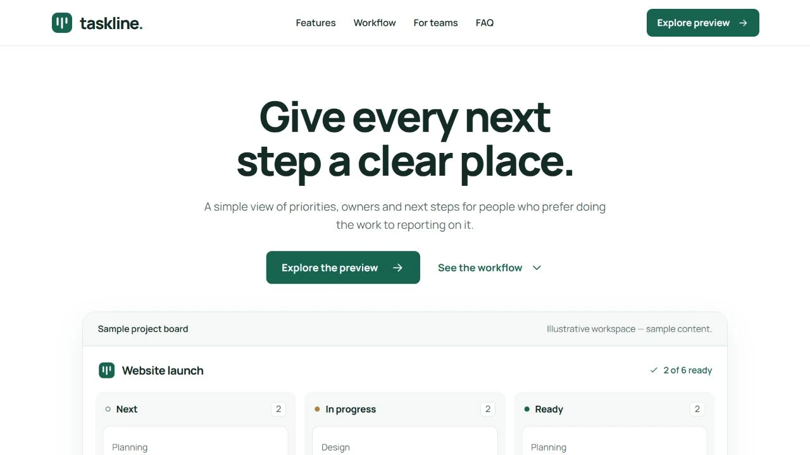

# Taskline Lite - free SaaS landing page website template

A calm, editable HTML landing page for a fictional work-planning product. A six-card project board, clear workflow, responsive navigation and smooth FAQs—all in HTML, CSS and vanilla JavaScript.

[Live preview](https://store.usmankhairdin.com/taskline-lite/?utm_source=github&utm_medium=referral&utm_campaign=taskline_lite_open_source) | [Template details and free download](https://store.usmankhairdin.com/templates/taskline-lite/?utm_source=github&utm_medium=referral&utm_campaign=taskline_lite_open_source) | [UKD Store](https://store.usmankhairdin.com/?utm_source=github&utm_medium=referral&utm_campaign=taskline_lite_open_source)

[](https://store.usmankhairdin.com/taskline-lite/)

## Get started

Choose **Code > Download ZIP**, extract the repository, and open `index.html` in a modern browser. Keep `assets/` beside the HTML file. No framework install, API key or database is required.

For an optional local HTTP preview, run this command inside the extracted folder:

```sh
python -m http.server 4210 --bind 127.0.0.1
```

Then open <http://127.0.0.1:4210/>. Python is one optional preview tool, not a dependency of the website.

## Included features

- Editable HTML, CSS and vanilla JavaScript; no React or Vite
- Six-card sample board with responsive stacked lanes
- Smooth FAQs and accessible mobile navigation
- Local Manrope font and Lenis scrolling with native fallbacks
- Compiled Tailwind CSS with optional rebuild tooling
- MIT license and detailed setup/domain-upload guide

## Make it yours

Edit the content and metadata in `index.html`, styles in `assets/css/taskline.css`, and interactive data/behaviour in `assets/js/taskline.js`. Replace the demonstration identity, contact destinations and illustrative claims with your own accurate information. Preserve filenames and relative paths when replacing assets.

Taskline is a fictional product. The six-card board is illustrative HTML, not a working task-management application. Accounts, task persistence, signup, payments and backend services are not included.

Connect your own secure backend or service if you need real submissions. Never place private credentials in frontend files.

Upload the supplied files to an ordinary static host or domain subfolder. No build command is needed. Detailed editing, hosting and fallback instructions are in [README.txt](README.txt).

### Optional Tailwind editing

The supplied CSS is ready to use. If you add new Tailwind utility classes, the pinned optional tooling is included:

```sh
npm ci --ignore-scripts
npm run build:css
```

This is CSS tooling only; no application framework or runtime build is required to use the supplied page.

## Licence and asset credits

Template code is distributed under the [MIT licence](LICENSE), including personal and commercial use subject to its notice requirements. Retain the included copyright and licence notices. Fonts, libraries and any stock photography retain their own terms; the MIT code licence does not relicense those assets. See [THIRD_PARTY_NOTICES.txt](THIRD_PARTY_NOTICES.txt) and [licenses/](licenses/).

Taskline Lite adapts the MIT-licensed [Landwind foundation by Themesberg](https://github.com/themesberg/landwind). The original Themesberg copyright and dependency notices are retained.

## More from UKD Store

Browse [premium website and dashboard templates](https://store.usmankhairdin.com/templates/?utm_source=github&utm_medium=referral&utm_campaign=taskline_lite_open_source), or explore the [free collection](https://store.usmankhairdin.com/collections/free-templates/?utm_source=github&utm_medium=referral&utm_campaign=taskline_lite_open_source).

Designed & developed by **[Usman Khair Din](https://www.usmankhairdin.com/)**
